<p align="center"></p>

# email-deliverability-suite

[](https://github.com/andrewluxem/email-deliverability-suite/actions/workflows/ci.yml)
[](LICENSE)
[](pyproject.toml)

`deliv` is a command-line toolkit for email deliverability. It runs real checks and gives you graded reports
you can act on. It is not a docs repo or a thin scanner.

- **Eight tools, one CLI:** DNS authentication audit, spam-risk scoring, a pre-send QA gate, header analysis,
  bounce classification, blocklist checks, warmup planning, and a shareable report.
- **Graded and explained:** every check returns PASS, WARN, or FAIL with a plain-English reason and a fix. The
  results roll up into a 0-100 score and an A-F grade.
- **Scriptable:** every command takes `--json`. `copy-check` exits 0/1/2 so it can gate a CI pipeline or ESP hook.
- **Tested:** about 300 tests, all offline. DNS, HTTP, and sockets are mocked at the boundary, and CI runs ruff
  and pytest on Python 3.10, 3.11, and 3.12.
- **Agent-ready:** ships a [Claude Code skill](skills/deliverability/SKILL.md) that teaches an agent when to run
  each command and how to read the results.

## Install

```bash
pipx install git+https://github.com/andrewluxem/email-deliverability-suite
deliv --version
```

To work on the code instead:

```bash
git clone https://github.com/andrewluxem/email-deliverability-suite
cd email-deliverability-suite
python -m pip install -e ".[dev]"
```

The runtime dependencies are [Typer](https://typer.tiangolo.com/) and [dnspython](https://www.dnspython.org/).

## Quickstart

```bash
deliv dns-audit example.com                  # grade SPF, DKIM, DMARC, BIMI, MTA-STS, TLS-RPT
deliv copy-check campaign.html               # PASS / REVIEW / FAIL before you hit send
deliv header-analyze delivered.eml           # why did this land in spam?
deliv bounce-classify "550 5.1.1 user unknown"
deliv blacklist 192.0.2.25
deliv warmup-plan --esp gmail --start-volume 50 --target-volume 50000 --days 30

# One shareable report from several runs
deliv dns-audit example.com --json > dns.json
deliv copy-check campaign.html --json > qa.json
deliv report -i dns.json -i qa.json --format html -o deliverability-report.html
```

Run `deliv <command> --help` for the options of any command.

## The tools

All sample output below is real `deliv` output. The domains, IPs, and messages are fictional.

### `deliv dns-audit <domain>`

This checks the DNS records that decide inbox placement:

- **SPF:** the record exists, the syntax is valid, lookups stay within the 10-lookup limit (includes are followed
  recursively), and the record ends in `-all` or `~all`. `+all` is a critical fail.
- **DKIM:** probes `google`, `selector1`, `selector2`, `default`, `k1`, `k2`, `dkim`, plus any `--selector` you pass.
  It flags revoked keys and RSA keys shorter than 2048 bits.
- **DMARC:** checks the policy (`none` warns), `pct`, `rua`/`ruf` reporting, the subdomain policy, and alignment
  mode.
- **BIMI:** checks the record, the DMARC enforcement prerequisite, and the Verified Mark Certificate (VMC).
- **MTA-STS:** checks the TXT record, fetches `https://mta-sts.<domain>/.well-known/mta-sts.txt`, validates it, and
  confirms it covers every MX host.
- **TLS-RPT:** checks that the record and a reporting address exist.

```text
$ deliv dns-audit example.com
DNS authentication audit: example.com
=====================================
Grade B (80/100)   7 passed, 4 warnings, 0 failed across SPF, DKIM, DMARC, BIMI, MTA-STS, and TLS-RPT.

SPF
  PASS  SPF record   Valid SPF record: v=spf1 include:_spf.esp.example.net ~all
  PASS  SPF lookups  SPF uses 1 of 10 allowed DNS lookups.
  PASS  SPF policy   SPF ends in ~all: unlisted senders soft fail (DMARC does the enforcing).

DKIM
  WARN  DKIM  DKIM found at selector1, but selector1 uses a 1024-bit key.
              fix: Rotate to a 2048-bit RSA key at your next key rotation.

DMARC
  PASS  DMARC record      Valid DMARC record: v=DMARC1; p=none; rua=mailto:dmarc@example.com
  WARN  DMARC policy      Policy is p=none: you get reports, but spoofed mail is still delivered.
                          fix: Review rua reports, fix any legitimate senders that fail, then move to p=quarantine and later p=reject.
  PASS  DMARC pct         Policy applies to 100% of failing mail.
  PASS  DMARC reporting   Aggregate reports go to mailto:dmarc@example.com; no ruf= (few receivers send them anyway).
  PASS  DMARC subdomains  Subdomains inherit p=none (no sp= tag).
  INFO  DMARC alignment   DKIM alignment is relaxed, SPF alignment is relaxed.

BIMI
  INFO  BIMI  No BIMI record (optional: shows your logo beside messages in supporting inboxes).
              fix: BIMI needs DMARC at quarantine or reject, an SVG Tiny PS logo, and for Gmail and Apple Mail a Verified Mark Certificate (VMC) or Common Mark Certificate.

MTA-STS
  WARN  MTA-STS record  No MTA-STS record, so inbound mail to this domain can be downgraded to plaintext.
                        fix: Publish 'v=STSv1; id=<timestamp>' at _mta-sts.example.com and a policy file at https://mta-sts.example.com/.well-known/mta-sts.txt (start with mode: testing).

TLS-RPT
  WARN  TLS-RPT  No TLS-RPT record, so you will not hear about TLS delivery failures.
                 fix: Publish 'v=TLSRPTv1; rua=mailto:tls-reports@example.com' at _smtp._tls.example.com.
```

**Scoring.** A pass earns a check's full weight, a warn earns half, a fail earns nothing, and info is not scored.
A failed critical check caps the grade at F. The critical checks are: no SPF record, no DMARC record, a broken
SPF record, and `+all`. Timeouts become warnings that suggest a longer `--timeout`. The audit never crashes on a
timeout.

### `deliv spam-scan <file>`

This scores `.txt`, `.html`, or `.eml` copy (or `-` for stdin) against the 186 weighted phrases in
[`data/spam_triggers.json`](data/spam_triggers.json). The phrases fall into seven categories: urgency, money,
free, health, adult, shady (phishing-adjacent), and formatting. Formatting uses pattern checks for shouting,
`!!!`, `?!`, `$$$`, and stacked `% off` claims. Matching is case-insensitive and respects word boundaries. When
two phrases overlap, only the heavier one counts. A repeated phrase adds less each time, and a match in the
subject line counts 1.5x.

```text
$ deliv spam-scan promo.html
Spam-risk scan: promo.html (HTML input)
=======================================
Grade F (39/100)   11 trigger matches across 5 categories.

Category breakdown
Category    Matches  Points lost
----------  -------  -----------
urgency     3        -17
money       1        -9
free        2        -13
health      0        0
adult       0        0
shady       3        -15.25
formatting  2        -7

Matches
Where   Found                 Category    Weight
------  --------------------  ----------  ------
line 1  ACT NOW               urgency     6
line 1  !!!                   formatting  3
line 1  Limited time offer    urgency     5
line 3  claim your free       free        6
line 3  Click here            shady       5
line 3  This is not spam      shady       9
line 5  100% free             free        7
line 5  $$$                   formatting  4
line 5  Make money fast       money       9
line 7  before it's too late  urgency     6
line 7  Click here            shady       5

Suggested rewrites (highest weight first)
  1. "This is not spam" (line 3): Remove; it is a classic spam tell.
  2. "Make money fast" (line 5): Remove; describe the real opportunity with specifics.
  3. "100% free" (line 5): Say 'at no cost' once, near the offer details.
```

Pass `--triggers my_triggers.json` to use your own list. It takes the same format.

### `deliv copy-check <file>`: the pre-send QA gate

This is the open-source version of an enterprise pre-send QA workflow. It runs `spam-scan` and then checks:

- link shorteners (bit.ly, tinyurl, t.co, and 27 more)
- the capitalization ratio
- exclamation-mark density and `!!`/`??` runs
- the image-to-text ratio and missing alt text
- Gmail's 102 KB clipping limit
- a visible unsubscribe link or ESP merge tag
- one-click `List-Unsubscribe` / `List-Unsubscribe-Post` headers (from `.eml` input)
- a physical mailing address
- subject-line length and shouting (from `.eml` input)

| Verdict | Exit code | Meaning |
| --- | --- | --- |
| PASS | 0 | Nothing to fix. |
| REVIEW | 1 | Warnings a human should read before sending. |
| FAIL | 2 | At least one blocking problem. |
| (error) | 3 | The input file could not be read. |

```text
$ deliv copy-check promo.html
Pre-send QA report: promo.html
==============================
Verdict:  FAIL   (exit code 2)
Spam risk: Grade F (39/100)

Why
  - Spam score: Spam-risk grade F (39/100): copy is likely to be filtered.
  - Punctuation: 3 exclamation marks (9.7 per 100 words).
  - Link shorteners: 1 shortened link(s) hide their destination: https://bit.ly/3xYz.
  - Unsubscribe link: No visible unsubscribe link in the body.
  - Physical address: Could not find a physical mailing address.

Checklist
  FAIL  Spam score               Spam-risk grade F (39/100): copy is likely to be filtered.
                                 fix: Start with "This is not spam": Remove; it is a classic spam tell.
  PASS  Capitalization           9% of letters are capitals.
  FAIL  Punctuation              3 exclamation marks (9.7 per 100 words).
                                 fix: Keep it to one exclamation mark per email, at most.
  FAIL  Link shorteners          1 shortened link(s) hide their destination: https://bit.ly/3xYz.
                                 fix: Link directly to your own domain (use your ESP's click tracking or a branded link domain instead of a public shortener).
  PASS  Image-to-text ratio      No images; 31 words of text.
  PASS  Message size             HTML is 0.3 KB, under Gmail's 102 KB clipping limit.
  FAIL  Unsubscribe link         No visible unsubscribe link in the body.
                                 fix: Add an 'Unsubscribe' link to the footer. CAN-SPAM, CASL, and GDPR all expect one, and people who cannot find it hit 'Report spam' instead.
  INFO  List-Unsubscribe header  Not checkable from an HTML/text file: headers are added at send time.
                                 fix: Confirm your ESP adds List-Unsubscribe and List-Unsubscribe-Post (one-click); Gmail and Yahoo require both for bulk senders. Run copy-check on a test .eml to verify.
  WARN  Physical address         Could not find a physical mailing address.
                                 fix: Add your postal address (street address or registered PO box) to the footer; CAN-SPAM requires one. If it is there in a format deliv does not recognize, ignore this.

Copy fixes (highest-risk phrases first)
  1. "This is not spam" (line 3): Remove; it is a classic spam tell.
  2. "Make money fast" (line 5): Remove; describe the real opportunity with specifics.
  3. "100% free" (line 5): Say 'at no cost' once, near the offer details.
```

Use it in CI:

```yaml
- run: pipx install git+https://github.com/andrewluxem/email-deliverability-suite
- run: deliv copy-check emails/spring-sale.html
```

### `deliv header-analyze <file.eml>`

This parses every `Authentication-Results` header (one per reporting server) and walks the `Received` chain to
find the external sending IP. It then compares the From domain with the envelope-from and DKIM `d=` domains to
check DMARC alignment, and ends with a diagnosis.

```text
$ deliv header-analyze promo.eml
Header analysis: promo.eml
==========================
Subject: 20% off trail gear this week

Authentication results (per reporting server)
Reported by     SPF   DKIM  DMARC
--------------  ----  ----  -----
mx.example.org  pass  pass  fail

Received chain (most recent first)
Hop  From host              IP             By
---  ---------------------  -------------  --------------
1    mta12.esp.example.net  198.51.100.77  mx.example.org
Sending IP: 198.51.100.77 (mta12.esp.example.net)

Alignment
  From domain:      example.com
  Envelope-from:    esp.example.net  (not aligned)
  DKIM signers:     esp.example.net (pass)  (not aligned)
  Verdict:          NOT ALIGNED

Checks
  PASS  SPF        spf=pass for bounce-7781@esp.example.net (mx.example.org: domain of bounce-7781@esp.example.net designates 198.51.100.77 as permitted sender)
  PASS  DKIM       dkim=pass (d=esp.example.net).
  FAIL  DMARC      dmarc=fail for header.from=example.com (p=QUARANTINE dis=QUARANTINE)
                   fix: Get SPF or DKIM to both pass and align with the From domain (see the alignment check).
  FAIL  Alignment  Neither the SPF domain (esp.example.net) nor the DKIM domain(s) (esp.example.net) match the From domain (example.com).
                   fix: Set up custom DKIM for your From domain in your ESP (d=your domain); optionally a custom return-path on a subdomain so SPF aligns too.

Diagnosis
  Your ESP is authenticating as itself: DKIM is signed by esp.example.net and the return-path is esp.example.net, neither of which is example.com. Set up custom DKIM for example.com.
```

### `deliv bounce-classify`

This classifies an enhanced status code, DSN line, or raw bounce text as **hard**, **soft**, or **block**, and maps
it to **suppress**, **retry** (with a backoff schedule), or **investigate**. Rules are tried in order: Gmail,
Microsoft, Yahoo, and iCloud message patterns, then specific RFC 3463 codes, then generic bounce phrases, then
RFC 3463 code classes, and finally the bare SMTP reply code. Every result names the rule that matched and a
confidence level.

```text
$ deliv bounce-classify "550 5.7.1 messages from [192.0.2.25] weren't sent. part of their network is on our block list (S3150)"
Bounce classification
=====================
Classification: BLOCK (Microsoft)
Action:         investigate
Status code:    5.7.1
Matched rule:   microsoft-blocklist [provider], confidence high
Why:            Microsoft: the sending IP is on Microsoft's block list (delist via the Outlook.com sender support form).
Next step:      Do not suppress yet: fix the sending-side cause, then resend.
```

JSON mode is designed for suppression pipelines:

```text
$ echo "452 4.2.2 The recipient's inbox is out of storage space" | deliv bounce-classify --json
{
  "tool": "bounce-classify",
  "target": "4.2.2",
  "summary": "soft bounce -> retry",
  "classification": "soft",
  "action": "retry",
  "action_detail": "Retry with backoff (15m, 60m, 240m, 720m, 1440m); suppress after 3 consecutive soft bounces across 72 hours.",
  "status_code": "4.2.2",
  "smtp_code": "452",
  "provider": "Gmail",
  "rule": {
    "id": "gmail-over-quota",
    "source": "provider",
    "description": "Gmail: the recipient's mailbox is full."
  },
  "confidence": "high",
  "retry_after_minutes": [15, 60, 240, 720, 1440]
}
```

(`deliv_version`, `generated_at`, `input`, and `findings` are omitted above for brevity.) To classify a whole log,
use `cat bounces.log | deliv bounce-classify --batch --json`, which takes one bounce per line and adds counts per
class and action.

### `deliv blacklist <ip-or-domain>`

This queries the blocklists in parallel with a per-query `--timeout` (default 10s). A timeout, a rate-limit
response, or a refused query becomes a warning. The command never crashes on them.

```text
$ deliv blacklist 192.0.2.25
Blocklist check: 192.0.2.25 (ip)
================================
Grade D (67/100)   Listed on 1 of 6 blocklists. 1 list(s) could not give a trustworthy answer.

List            Zone                    Result      Details
--------------  ----------------------  ----------  ------------------------------------------------------------------------------
Spamhaus ZEN    zen.spamhaus.org        UNVERIFIED  no listing returned, but the list failed its own test query: result untrusted
Barracuda BRBL  b.barracudacentral.org  not listed
SpamCop         bl.spamcop.net          LISTED      listed (return code 127.0.0.2)
PSBL            psbl.surriel.com        not listed
Mailspike BL    bl.mailspike.net        not listed
UCEPROTECT L1   dnsbl-1.uceprotect.net  not listed
SORBS           dnsbl.sorbs.net         skipped     Skipped: this list has been retired.

Delisting
  SpamCop: https://www.spamcop.net/bl.shtml
```

By default, `deliv` also asks each list about its own published test entry. If a list does not report its test
entry as listed, its "not listed" answer is marked **unverified**. This catches the most common false all-clear:
Spamhaus silently refusing queries that come from public resolvers.

| List | Zone | Target | Access and limits |
| --- | --- | --- | --- |
| Spamhaus ZEN | `zen.spamhaus.org` | IPv4, IPv6 | Free for low-volume, non-commercial use through **your own** resolver. Public resolvers (8.8.8.8, 1.1.1.1) are refused. Commercial use needs a Data Query Service (DQS) key. |
| Spamhaus DBL | `dbl.spamhaus.org` | domain | Same terms as ZEN. |
| Barracuda BRBL | `b.barracudacentral.org` | IPv4 | Free. Barracuda asks heavy users to register their resolver IPs. |
| SpamCop | `bl.spamcop.net` | IPv4 | Free. Listings expire about 24 hours after reports stop. |
| PSBL | `psbl.surriel.com` | IPv4 | Free, with self-service removal. |
| Mailspike | `bl.mailspike.net` | IPv4 | Free for low volume. Only `127.0.0.2` means listed; `127.0.0.10`-`14` are reputation scores. |
| UCEPROTECT L1 | `dnsbl-1.uceprotect.net` | IPv4 | Free to query. Listings expire once abuse stops; paid express delisting is optional. |
| SURBL | `multi.surbl.org` | domain | Free for low volume; high volume needs a data feed. |
| URIBL | `multi.uribl.com` | domain | Free for low volume. Answers `127.0.0.1` when a resolver is over the limit (reported as an error). |
| SORBS | `dnsbl.sorbs.net` | IPv4 | **Retired.** Proofpoint shut SORBS down in 2024. Skipped unless you pass `--include-retired`. |

For reliable Spamhaus results, run `deliv blacklist <ip> --nameserver <your-resolver-ip>`.

### `deliv warmup-plan`

This builds a day-by-day geometric ramp. Volume never exceeds the provider's day-1 guidance or daily growth
guidance (`--esp gmail|outlook|yahoo|generic`). Each day lists the engagement window to send to, and the plan
includes the health gate to pass before each step up. If you ask for a ramp that is too fast, the plan runs longer
and tells you why.

```text
$ deliv warmup-plan --esp gmail --start-volume 100 --target-volume 20000 --days 14
Warmup plan: Gmail
==================
Planning guidance, not a guarantee of inbox placement. Mailbox providers place mail based on engagement, complaints, and authentication; adjust daily based on your results.

15-day ramp from 100 to 20,000 messages/day for Gmail.
Note: Reaching 20,000/day in 14 days would need 50.3% daily growth; Gmail guidance caps it at 50%. The plan runs 15 days. Keep the longer ramp, or split volume across more IPs or sending subdomains.

Day  Volume  Growth  Send to
---  ------  ------  ----------------------------
1    100     -       Engaged in the last 30 days
2    150     x1.50
3    220     x1.47
4    330     x1.50   Engaged in the last 60 days
5    490     x1.48
6    730     x1.49
7    1,050   x1.44
8    1,550   x1.48   Engaged in the last 90 days
9    2,300   x1.48
10   3,450   x1.50
11   5,150   x1.49
12   7,700   x1.50
13   11,500  x1.49   Engaged in the last 180 days
14   17,200  x1.50
15   20,000  x1.16
Total messages across the ramp: 71,920

Daily gate
  Advance to the next day's volume only if the previous day had a bounce rate under 2%, a spam complaint rate under 0.1%, and no spike in 4xx deferrals. Otherwise repeat the previous day's volume until the numbers recover.
```

The output ends with provider-specific notes, such as Postmaster Tools for Gmail and SNDS/JMRP for Microsoft. The
provider profiles are conservative planning defaults, not published limits. Opens, replies, and low complaint
rates matter more than raw volume.

### `deliv report`

This merges saved `--json` outputs into one report. `--input` is repeatable, and each file can hold a single
result, an array of results, or `{"results": [...]}`. The report opens with an executive summary and an overall
grade. It then lists fixes in priority order (P1 blocking issues first, and DNS and reputation fixes before
content fixes) and gives each tool its own section.

```bash
deliv report --input results.json --format md > report.md
deliv report --input results.json --format html --output report.html
```

The HTML version is one self-contained file. It has inline CSS, no scripts, and no external assets, and it
supports dark mode. You can email it or attach it to a ticket.

## Architecture

```text
src/deliv/
  cli.py              Typer app; registers one subcommand per tool
  lib/
    dns.py            DNSClient with injectable backend, timeout mapping, domain/IP helpers
    scoring.py        Finding + Status, weighted 0-100 scoring, critical caps, A-F grades
    output.py         result envelope, JSON serialization, shared terminal formatting
    content.py        text / HTML / .eml loading (visible text, links, images, headers)
    http.py           HTTPS fetch with timeout, size cap, and no redirects (MTA-STS)
    options.py        shared --json / --timeout / --nameserver option types
  checks/             dns-audit checks, one module per protocol (spf, dkim, dmarc, bimi, transport)
  dns_audit.py  spam_scan.py  copy_check.py  header_analyze.py
  bounce_classify.py  blacklist.py  warmup_plan.py  report.py  report_html.py
data/spam_triggers.json   curated, weighted trigger phrases (packaged into the wheel)
skills/deliverability/    Claude Code agent skill
tests/                    mirrors src/; fakes.py provides FakeDNS and FakeFetcher
```

Each tool follows the same pattern:

1. A pure function takes its inputs and returns a result dict built with `lib.output.envelope`. For example,
   `audit_domain(domain, client, fetcher)`.
2. The result carries `tool`, `target`, `summary`, and a `findings` list. Graded tools also carry `score` and
   `grade`.
3. The Typer `command()` parses options and calls `emit(result, as_json, render)`.

Network I/O goes only through `DNSClient` and the `fetch_text` fetcher, and both can be injected. That is why the
tests can cover every path without touching the network. `tests/conftest.py` blocks sockets for the whole suite
to enforce it.

## Roadmap

- `deliv dmarc-report`: parse DMARC aggregate (rua) XML into sender and alignment summaries.
- Optional Public Suffix List support for exact organizational-domain alignment.
- ARC chain validation in `header-analyze`.
- A `--strict` mode for `copy-check` that treats REVIEW as FAIL.
- Per-provider spam-trigger weighting and localized trigger lists.
- A PyPI release so installation is `pipx install email-deliverability-suite`.

## Limits worth knowing

- `spam-scan` is a heuristic based on a curated phrase list. It is not a copy of any mailbox provider's filter,
  and a good grade does not guarantee inbox placement.
- Physical address detection covers US, UK, and Canadian formats and common ESP merge tags. Other formats may
  come back as REVIEW.
- Organizational-domain alignment uses a built-in list of common multi-label suffixes (`co.uk`, `com.au`, ...)
  rather than the full Public Suffix List.

## Contributing and security

See [CONTRIBUTING.md](CONTRIBUTING.md) for how to add a check or a spam-trigger category, and
[SECURITY.md](SECURITY.md) to report a vulnerability. Released under the [MIT License](LICENSE).
